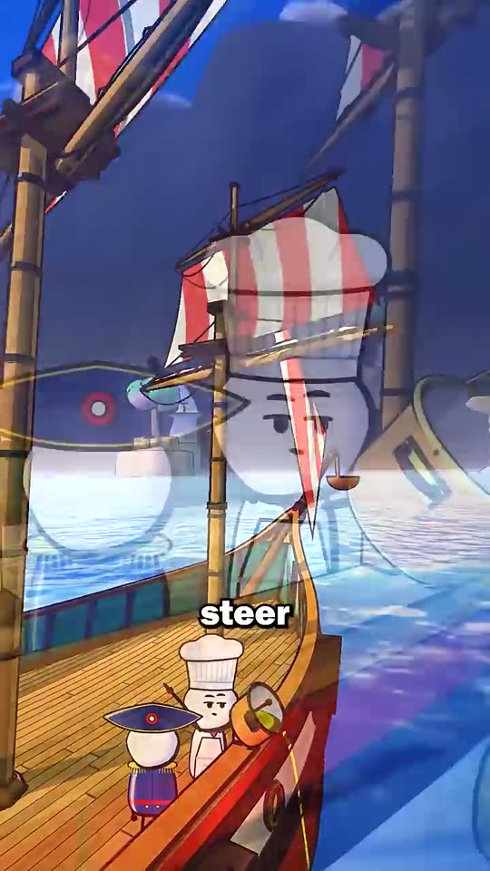
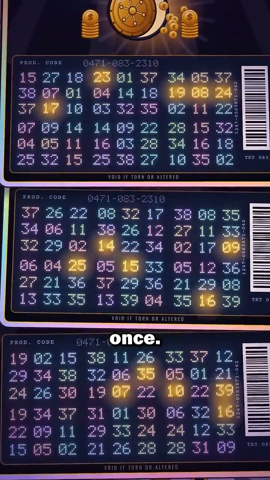
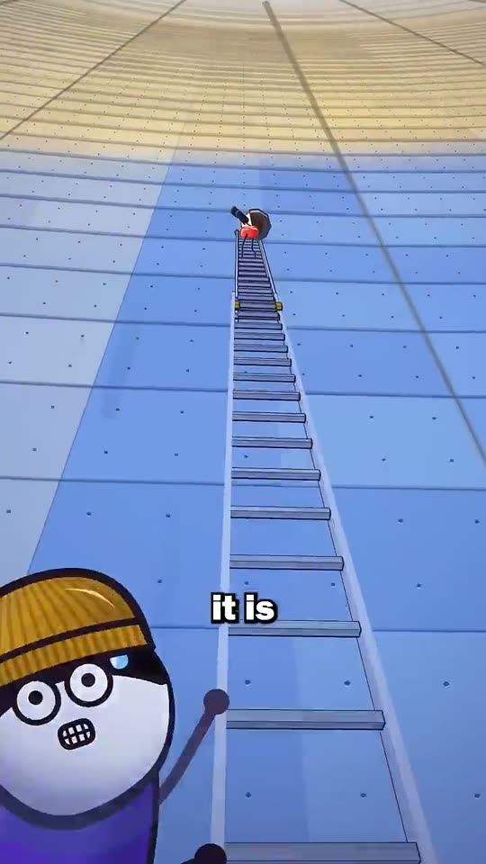
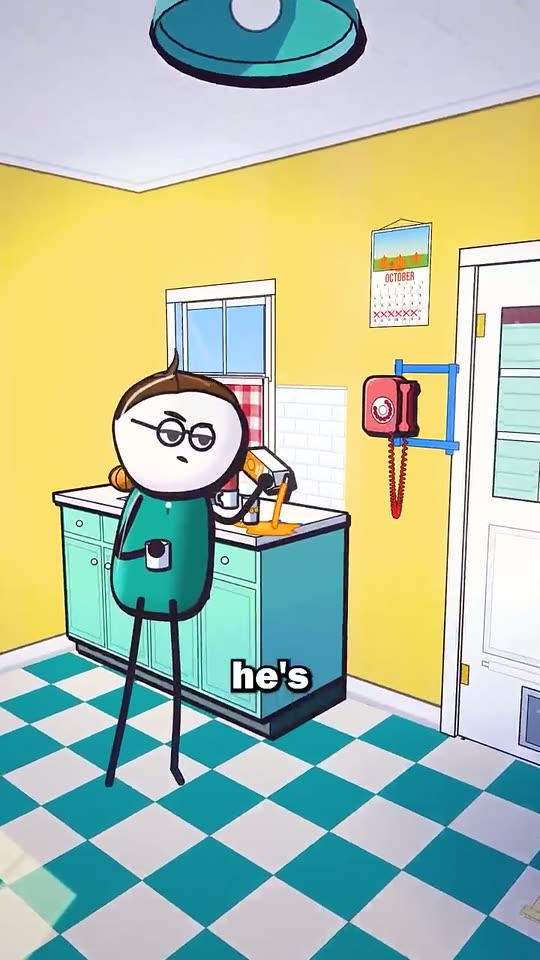
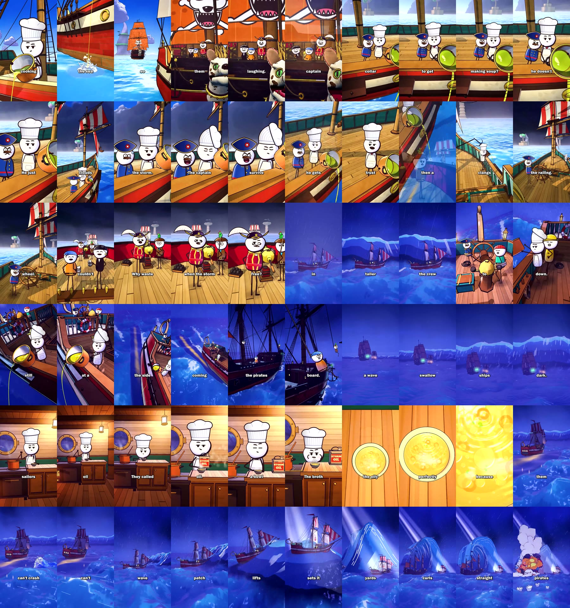
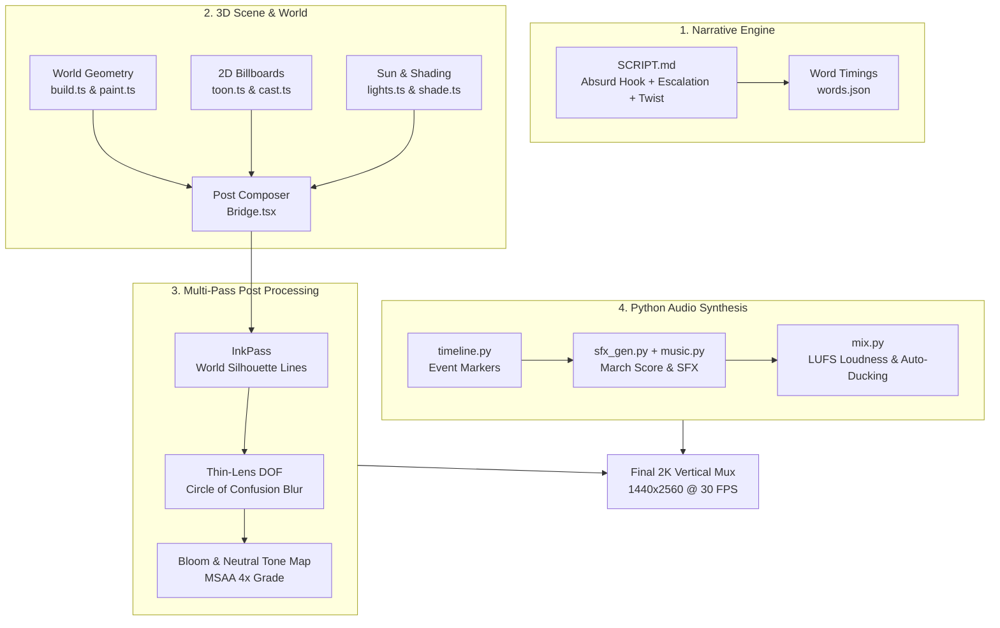

<div align="center">

**⚡ This skill makes videos by code.**

# 🎬 Viral Animation Lib
### Autonomous 3D Toon Animation Studio & Pipeline
**2D Bean-Head Characters in a Painted 3D World · Remotion · Three.js · Python DSP Audio**

[](https://www.remotion.dev/)
[](https://threejs.org/)
[](https://react.dev/)
[](https://www.typescriptlang.org/)
[](https://www.python.org/)
[](LICENSE)

<br/>

> **Create viral 55–70s vertical storytelling shorts rendered entirely on your own GPU with Three.js inside Remotion.**  
> *No AI video generators. No recurring subscription APIs. Pure procedural craft, mathematical lighting, and algorithmic sound design.*

---

</div>

## 📸 The Reel Aesthetic

The pipeline pairs flat, expressive 2D cartoon cards with an ink-outlined 3D miniature world, gliding cinematic cameras, lens bokeh, and synchronized procedural march scores.

### Frame Showcase

| Daylight Town | Golden Hour Rim Lighting |
| :---: | :---: |
|  |  |
| **High-Key Daylight:** Crisp horizon fog, muted brick albedos, cool ambient lift | **Golden Rim:** Peach horizon `#ffd08a`, violet-blue shadows, backlit bloom |

| Cinematic Depth-of-Field | Multi-Character Storytelling |
| :---: | :---: |
|  |  |
| **Thin-Lens Blur:** 10–16px bokeh on close-ups, eye-level focus | **Expressive Cards:** 14 face morphs, dynamic blinks, natural stride bobs |

<br/>

### Full Short Visual Progression (60-Frame Contact Sheet)
<div align="center">
  
  <p><em>67-second shot-by-shot escalation: hook → setting → escalation → snap → explanation → callback twist.</em></p>
</div>

---

## ⚡ Core Architecture



---

## 🎨 The Visual Formula (STYLE BIBLE)

Measured rigorously from high-performing viral shorts:

- **Bean-Head Characters (`toon.ts`):**
  - Card proportions: Height/width `0.94`, narrow chin, plum ink outline `#241726`.
  - Stick limbs: `0.055` head width with ink-dot hands.
  - Life & Motion: 14 distinct facial expressions, procedural blinks every 0.5–2.3s, 5% walk bob, and planted strides.
- **Painted 3D World (`build.ts`, `paint.ts`):**
  - Muted Victorian/storybook architecture: brick, cream, ochre, and terracotta with dark painted seams.
  - Automatic sight-line raycasting to cull any props blocking the camera trajectory.
- **Lighting Presets (`lights.ts`):**
  - **Day:** Azimuth 75° / Elevation 48°, cool tint in shade only (`[0.30, 0.29, 0.36]`), saturated sky `#3e7fd2` fading to `#b8d0ec`.
  - **Golden:** Azimuth 6° / Elevation 7° backlit key toward `#FFB36B`, violet-blue architectural shadows, peach fog past 50m.
- **World & Character Ink (`ink.ts`):**
  - World lines: Crisp 3px near-black `#0b0a0c` lines on silhouettes and normal creases.
  - Character cards stay on layer `NOINK` (preserving their hand-crafted plum outlines).

---

## 🎵 Synthetic Audio Pipeline

Zero dependency on external audio libraries or stock music subscriptions:

- **March Score Generator (`music.py`):** Algorithmic brass, snare rolls, bass drums, and harmonic progressions keyed to scene beats.
- **Procedural Sound FX (`sfx_gen.py`):** Synthesized wood creaks, marching footfalls, iron snaps, splashes, and crowd murmurs.
- **Automated Mixing Desk (`mix.py`):**
  - True-peak limiting and dynamic sidechain ducking under narration.
  - Standard loudness balance: Music `+3 dB`, SFX `-6 dB`, voice untouched.

---

## 🚀 Quick Start

### 1. Prerequisites
- **Node.js** v18+ & **npm**
- **Python** 3.10+
- **Google Chrome** (for headless GPU rendering via ANGLE)
- **ffmpeg** (for video & audio muxing)

### 2. Installation
```bash
# Clone the repository
git clone https://github.com/baerozgaarmard/viral-animation-lib.git
cd viral-animation-lib

# Install Node dependencies
npm install

# Install Python audio & QA dependencies
pip install scipy pillow numpy
```

### 3. Launch Remotion Studio
Preview and scrub the 3D scene in real-time in your browser:
```bash
npm start
```

### 4. Render Test Stills
Render fast test stills using headless Chrome with hardware acceleration:
```bash
# Render frame 100 at 50% scale
node scripts/bridge-stills.mjs out/preview_ 100 0.5

# Render multiple frames
node scripts/bridge-stills.mjs out/preview_ 60,180,300 0.5
```

### 5. Generate Audio Mix
```bash
python scripts/mix.py
```

### 6. Production 2K Render
Render the final 1440x2560 vertical master:
```bash
npx remotion render src/index.ts BridgeShort out/video.mp4 --codec h264 --crf 16 --scale 1.3333
```

---

## 🤖 AI Agent Integration (Claude Code & Antigravity)

This repository includes [`SKILL.md`](SKILL.md), enabling coding agents to autonomously research, script, storyboard, generate 3D layouts, and render full animated shorts.

- **For Antigravity:** The skill is active via `cartoon-3d-short`.
- **For Claude Code:** Simply prompt:
  > *"Use the cartoon short skill and make a short about the Tacoma Narrows Bridge collapse."*

The agent handles the entire 11-step pipeline from historical fact research to final frame-by-frame QA.

---

## 📁 Repository Structure

```
├── src/
│   ├── index.ts               # Remotion entrypoint
│   ├── Root.tsx               # Composition registry
│   └── videos/bridge/         # The proven 67s Bridge Short
│       ├── Bridge.tsx         # Main post-processing composition
│       ├── world.ts           # 3D Three.js scene, sky & sun
│       ├── build.ts           # Procedural buildings & prop culler
│       ├── toon.ts            # 2D Canvas bean-head character artist
│       ├── cast.ts            # Billboard actors, walk cycles, blinks
│       ├── ink.ts             # World outline shader pass
│       ├── lensblur.ts        # Thin-lens depth of field bokeh
│       ├── lights.ts          # Day & Golden lighting presets
│       ├── paint.ts           # Procedural painted textures
│       ├── shade.ts           # Two-tone toon cel shading
│       └── story.ts           # Camera timeline, glides & kicks
├── scripts/                   # Stills, side-by-side QA & audio synthesis
│   ├── bridge-stills.mjs      # Fast headless still renderer
│   ├── short_qa.py            # Automated black/frozen/pop frame checker
│   ├── sbs_sheet.py           # Side-by-side comparison generator
│   ├── mix.py                 # 48kHz audio mixer & ducker
│   ├── music.py               # Procedural march music synthesizer
│   └── sfx_gen.py             # Procedural sound effect generator
├── references/                # Reference material & measurements
│   ├── STYLE_BIBLE.md         # Formula derived from 20 top shorts
│   ├── frames/                # 38 high-res reference frames (540x960)
│   ├── sheets/                # 20 full-length 60-frame contact sheets
│   └── reports/               # Measured reports (lighting, depth, ink, motion)
├── templates/                 # SCRIPT and Sandbox starter templates
├── SKILL.md                   # Agent execution instructions
└── package.json               # Dependencies & scripts
```

---

## 🛡️ Privacy & Quality Rules

- **Zero Bloat:** Created videos, audio renders, local voice tracks, and agent memory logs are strictly excluded via `.gitignore`.
- **Procedural Independence:** Designed to run 100% locally on your machine with no external generative API charges.

---

## 📜 License

The code, shaders, audio synthesis modules, and documentation are licensed under the [MIT License](LICENSE).  
*Reference frames and sheets are included for style study and measurement.*
